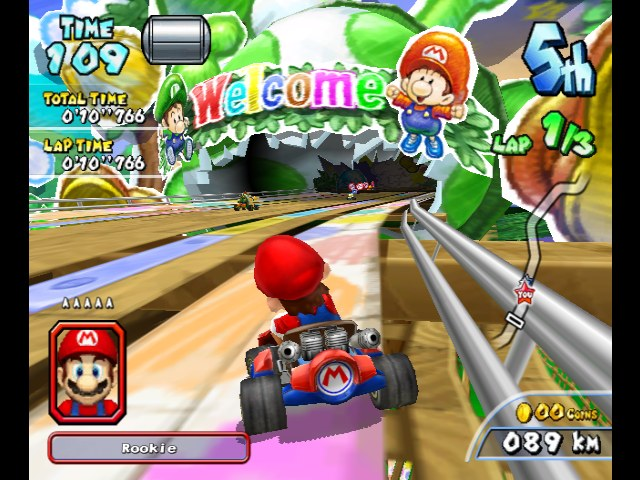
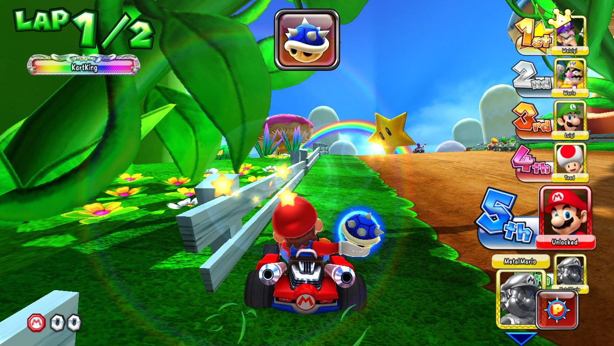

# Nintendo Arcade Launcher

One launcher for Nintendo's arcade games: **F-Zero AX Monster Ride** and
**Mario Kart Arcade GP 2** (Sega Triforce), **Mario Kart Arcade GP DX**
(Namco ES3) and **Luigi's Mansion Arcade** (Sega Nu), on Linux and Windows. Point it at the folder with your own
game dumps and press **Play**: it finds each game, sets up the emulator or
loader, and runs it full screen with your pad or wheel. Built on
[rea-launcher-sdk](https://github.com/akitaonrails/rea-launcher-sdk), like
its sister launchers for
[Initial D](https://github.com/akitaonrails/rea-teknoparrot-initial-d-series)
and [Wangan Midnight](https://github.com/akitaonrails/rea-teknoparrot-wangan-series).

No game files are included or downloaded. Your game folders are only
read, never changed: every game runs from a private folder.

| | |
|---|---|
|  |  |
| F-Zero AX Monster Ride, past the motion seat it can't find | Mario Kart Arcade GP 2, past the camera it can't find |
|  |  |
| Mario Kart Arcade GP DX through windowsarcadeloader | Luigi's Mansion Arcade, aimed from the launcher's pad input |

## What runs

| Game | Board | How it runs | Linux | Windows |
|---|---|---|---|---|
| F-Zero AX Monster Ride (Japan, SBHA6W) | Sega Triforce | Dolphin 2609b | **plays** | not yet run |
| Mario Kart Arcade GP 2 (MK21 Ver. A) | Sega Triforce | Dolphin 2609b | **plays** | not yet run |
| Mario Kart Arcade GP DX (1.18.16) | Namco ES3 | windowsarcadeloader (patched) | **plays** | not yet run |
| Luigi's Mansion Arcade (SDCF) | Sega Nu | windowsarcadeloader (patched) | **plays** | not yet run |

"Plays" means a race was driven (or, for Luigi's Mansion, a stage played)
in the real game through the launcher, with its own input path; each run is recorded in
[docs/RUNTIME_NOTES.md](docs/RUNTIME_NOTES.md). Only the exact builds
listed in the hub are started (each is identified by the SHA-256 of its
disc image or program, under any file name); another build shows its
digest so you can report it.

## Why not just TeknoParrot?

- **It is a Windows .NET program**, and on Linux it means Wine, a dedicated
  prefix and per-game tuning (the sister projects shelved that route).
- **Its Triforce emulator is a private Dolphin build.** Mainline Dolphin has
  run Triforce since early 2026, open and maintained.
- **Cabinet hardware stops the games.** Monster Ride waits forever for its
  CyCraft motion seat; Mario Kart GP 2 stops on CAMERA ERROR.
- **The first boot of Monster Ride wants a handle that tilts.** Its
  adjustment screen won't take Start until the handle has moved up and
  down as well as left and right.
- **Controls are set up per game** in the UI, by device.

## What this launcher does about it

- **Open emulators and loaders only:** mainline Dolphin for the Triforce
  games, windowsarcadeloader (GPL) for Mario Kart DX. No TeknoParrot.
- **Luigi's Mansion with a pad:** the left stick moves the crosshair, so
  no lightgun is needed; on Linux a mouse or a lightgun aims as well
  (windowsarcadeloader reads them, `patches/wal/0003`).
- **Monster Ride without its seat:** the community's "Bypass Cycraft" code,
  written into Dolphin's settings for that game only.
- **Mario Kart GP 2 without its camera:** Dolphin's own "Skip Boot Check"
  code for that disc, turned on for it.
- **Mario Kart DX without its camera:** the operator settings that come
  with the dump (camera and card units off) are put on the game's F: and
  G: drives at its first start; it stopped on E08-01 NAMCAM ERROR
  otherwise. Its Wine prefix gets what windowsarcadeloader installs,
  minus two DirectMusic pieces only web.archive.org still hosts.
- **The handle's tilt:** the launcher carries it on the emulated stick
  (a pad's left stick, or W/Q on the keyboard).
- **Full steering:** Dolphin's emulated stick normally stops at 79 % of its
  travel; the launcher opens its gate so a wheel reaches full lock.
- **Your dumps stay untouched.** Logs, saves and settings land in the
  game's private folder; on Linux every library folder is mounted
  read-only around the game.

## What it adds

- **One hub for the four games**, with an original illustration for each,
  driven by pad, keyboard or mouse.
- **Wheel and pad support for every game.** Pads and wheels are read once
  with SDL: analog steering and pedals, a stick dead zone, wheels
  recognised from the SDK's table. On Linux the Triforce games get them
  through Dolphin's pipe input, so a wheel needs no setup in Dolphin; the
  wheel gets a centring spring and damping (Dolphin plays no force
  feedback for these games). Mario Kart DX's own force feedback is played
  on the wheel. The Controls page shows live steering, pedals and buttons.
- **Up to 4K**: Dolphin's internal resolution (480 lines × 1 to 8), Mario
  Kart DX's render size.
- **Screen options on Linux** through gamescope: output size, FSR 1, NVIDIA
  Image Scaling, sharp or smooth scaling, full screen.
- **Everything bundled:** Dolphin (built from source for Linux),
  windowsarcadeloader, its Wine (GE-Proton) and winetricks.

## Download and install

Packages are on the [releases page](https://github.com/akitaonrails/rea-teknoparrot-nintendo-series/releases).

**Linux** (`NintendoArcadeLauncher-<version>-linux-x86_64.tar.gz`): unpack
it anywhere and run `./nintendo-launcher`. It brings Dolphin,
windowsarcadeloader and its Wine. You need gamescope, bubblewrap (`bwrap`),
a Vulkan driver, 32-bit OpenGL and `cabextract` (winetricks installs the
Windows games' Microsoft runtimes with it, once). A mouse or lightgun for
Luigi's Mansion is read from `/dev/input`, which your user must be allowed
to read (usually the `input` group); a pad works without it.

**Windows** (`NintendoArcadeLauncher-<version>-windows-x86_64.zip`): unpack
it anywhere and run `nintendo-launcher.exe`. It brings Dolphin and
windowsarcadeloader. Windows 10 or 11, 64-bit.

## First run

The first window asks for the folder that holds your game folders (the
TeknoParrot layout works as is) and, optionally, the Triforce test-menu
program `segaboot.gcm` (only the operator test menu needs it). Then pick a
game and press **Play**.

## Controls

| Pad | Cabinet |
|---|---|
| Left stick | Steering (and, up/down, the Monster Ride handle's tilt) |
| RT / LT | Gas / brake |
| A | Item (Mario Kart) / boost (F-Zero AX) |
| B | Mario button / view change |
| LB / RB | Paddles (F-Zero AX) / menu up, down (Mario Kart DX) |
| X | Enter (Mario Kart DX) |
| Start | Start |
| Back | Coin |
| Y | Card (Mario Kart DX) |

Luigi's Mansion Arcade: the left stick moves the crosshair, RT or A
vacuums (the trigger), B is the gun's button, Start joins. On Linux a
mouse (left button: trigger and join) or a lightgun aims too; whichever
moved last aims.

Keyboard (Triforce games): arrows steer, Up/Down gas and brake, W/Q tilt
the handle, Z item/boost, X Mario button/view, A/S paddles, Enter start,
5 coin, 9 test, 0 service.

F-Zero AX Monster Ride asks for its handle and pedal adjustment at boot:
turn the wheel both ways, push the left stick (or W/Q) up and down, press
both pedals, then Start. The Mario Kart GP 2 menus decide with the gas
pedal.

## Options

Per game, in the Settings window or on the command line (`--help` lists
them): the size the game draws at and the stick dead zone; on Linux also
the size shown on screen, the upscaler (FSR 1, NIS, smooth, sharp pixels)
and its sharpness, and full screen.

```sh
nintendo-launcher --play fzax
nintendo-launcher --game mkgp2 --render 2560x1440 --output 3840x2160 --upscaler fsr
nintendo-launcher --list
```

## Where things live

| What | Linux | Windows |
|---|---|---|
| Settings, logs | `~/.local/share/rea-nintendo/` | `%LOCALAPPDATA%\rea-nintendo\` |
| Each game's private folder, saves included | `…/runtimes/<game>/` (Dolphin's user folder in `dolphin/`) | same |

Each run writes `runtimes/<game>/session.log`.

## Known limitations

- The first start of Mario Kart DX or Luigi's Mansion installs Microsoft
  runtimes through winetricks (a few minutes, from Microsoft and GitHub);
  it needs the network once.
- Luigi's Mansion on Windows aims with the pad only (windowsarcadeloader
  reads mice and lightguns on Linux).
- Mario Kart GP 2 looks for its three linked cabinets for about a minute
  at every boot.
- Monster Ride asks for its adjustment at every boot so far.
- Not checked yet: a real wheel, Windows, sound on speakers.

## For developers

```sh
cargo test                              # core and window tests, headless
scripts/build-launcher.sh linux         # or: windows (MinGW, LLD)
scripts/build-components.sh <dir>       # Dolphin, windowsarcadeloader, Wine, art
scripts/package.sh linux                # or: windows
```

`crates/nintendo-core` holds everything that decides (catalog of exact
builds, library scan, runtime folders, settings, launch plans for each
OS, Dolphin's configuration and pipe commands) with host tests;
`crates/nintendo-launcher` holds the window, the CLI, SDL input and the
session. Research and decisions: [docs/RESEARCH.md](docs/RESEARCH.md);
what was run and seen: [docs/RUNTIME_NOTES.md](docs/RUNTIME_NOTES.md).

## Credits

Dolphin (and crediar's Triforce work), windowsarcadeloader (aderumier),
GE-Proton, winetricks, SDL, teknogods. Details and licences:
[THIRD_PARTY.md](THIRD_PARTY.md). The hub art is original, drawn by
`scripts/art/scenes.py`.

## Legal

GPL-3.0-or-later. F-Zero, Mario Kart and Luigi's Mansion are trademarks of Nintendo; this
project is not affiliated with Nintendo, SEGA, Capcom or Bandai Namco. The launcher
runs only builds you already have, and it never tells anyone where to get
game files.
