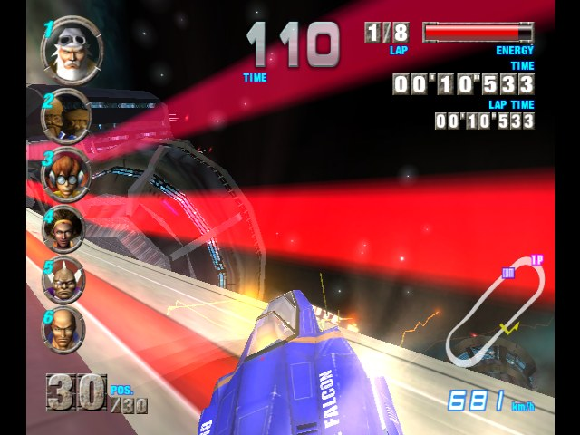
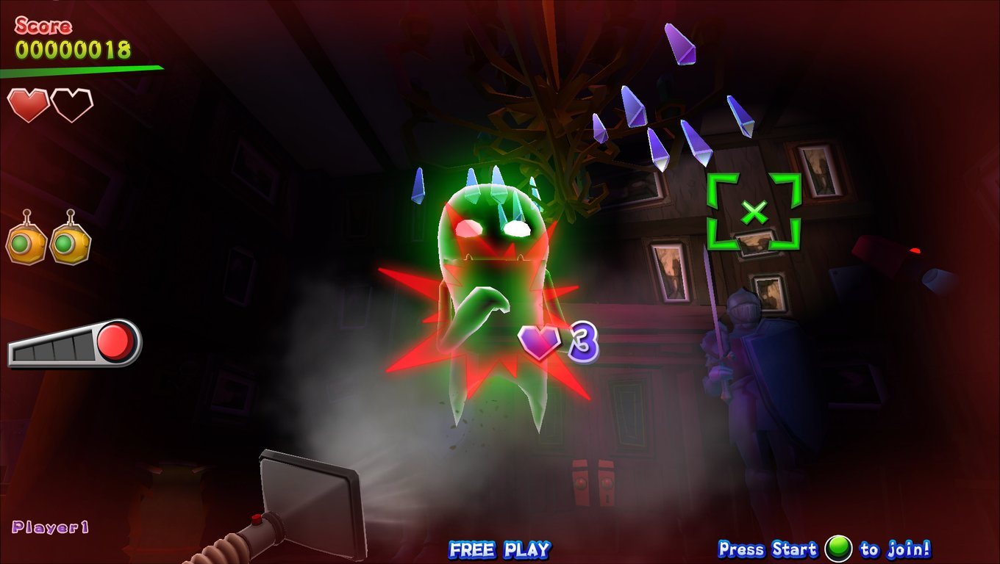

# Nintendo Arcade Launcher

One launcher for Nintendo's arcade games: **F-Zero AX Monster Ride** and
**Mario Kart Arcade GP 2** (Sega Triforce), **Mario Kart Arcade GP DX**
(Namco ES3) and **Luigi's Mansion Arcade** (Sega Nu), on Linux and Windows.
Point it at the folder with your own game dumps and press **Play**: it finds
each game, sets up the emulator or loader, and runs it full screen with your
pad or wheel.

No game files are included or downloaded. Your game folders are only
read, never changed: every game runs from a private folder.

> Every game has been played through the launcher on Linux. The Windows
> version starts the same way but no game has been played on Windows yet.
> Reports are welcome: [open an issue](https://github.com/akitaonrails/rea-teknoparrot-nintendo-series/issues/new/choose).

<!-- showcase video: slot for the owner's recording -->

## Problems this launcher solves

| Problem | What the launcher does |
| --- | --- |
| TeknoParrot is a Windows program, and on Linux it means Wine, a dedicated prefix and per-game tuning. | Open emulators and loaders only: mainline Dolphin for the Triforce games, windowsarcadeloader for Mario Kart DX and Luigi's Mansion, with its Wine (GE-Proton) bundled. |
| TeknoParrot's Triforce emulator is a private Dolphin build. | Mainline Dolphin, which has run the Triforce since early 2026, open and maintained. |
| Monster Ride waits forever for its CyCraft motion seat. | The community's "Bypass Cycraft" code, written into Dolphin's settings for that game only. |
| Mario Kart GP 2 stops on CAMERA ERROR. | Dolphin's own "Skip Boot Check" code for that disc, turned on for it. |
| Mario Kart DX stops on E08-01 NAMCAM ERROR. | The operator settings that come with the dump (camera and card units off) are put on the game's drives at its first start. |
| Luigi's Mansion needs a lightgun. | The left stick moves the crosshair; on Linux a mouse or a lightgun aims as well. |
| Monster Ride's first boot wants a handle that tilts. | The tilt is on the stick's up and down (a pad's left stick, or W/Q on the keyboard). |
| Dolphin's emulated stick stops at 79 % of its travel. | The launcher opens its gate, so a wheel reaches full lock. |
| Controls are set up per game and per device. | Pads and wheels are read once for every game: analog steering and pedals, a stick dead zone, wheels recognised by the launcher. The Triforce games get a centring spring on the wheel; Mario Kart DX's own force feedback is played on it. |
| Games write logs, saves and settings next to their files. | Those land in the game's private folder; on Linux every game folder is mounted read-only while a game runs. |

It also draws the games larger than the cabinets did (up to 4K: Dolphin's
internal resolution, Mario Kart DX's render size) and, on Linux, scales the
picture to your screen with FSR 1, NVIDIA Image Scaling, smooth or sharp
pixels.

## Screenshots

| | |
|---|---|
|  |  |
| F-Zero AX Monster Ride, past the motion seat it can't find | Mario Kart Arcade GP 2, past the camera it can't find |
|  |  |
| Mario Kart Arcade GP DX through windowsarcadeloader | Luigi's Mansion Arcade, aimed from the launcher's pad input |

## What you need

Your own dumps of these builds (the launcher recognises each one by its
contents, under any file name; another build is listed as unknown, so you
can report it):

| Game | Build | Linux | Windows |
|---|---|---|---|
| F-Zero AX Monster Ride | Japan, SBHA6W | **plays** | not yet run |
| Mario Kart Arcade GP 2 | MK21 Ver. A | **plays** | not yet run |
| Mario Kart Arcade GP DX | 1.18.16 (English mod) | **plays** | not yet run |
| Luigi's Mansion Arcade | SDCF | **plays** | not yet run |

"Plays" means a race was driven (or, for Luigi's Mansion, a stage played)
in the real game through the launcher ([docs/RUNTIME_NOTES.md](docs/RUNTIME_NOTES.md)).

- **Linux:** gamescope, bubblewrap (`bwrap`), a Vulkan driver, 32-bit
  OpenGL and `cabextract`. A mouse or lightgun for Luigi's Mansion is read
  from `/dev/input`, which your user must be allowed to read (usually the
  `input` group); a pad works without it.
- **Windows:** Windows 10 or 11, 64-bit.
- Optional: the Triforce test-menu program `segaboot.gcm` (only the
  operator test menu needs it).

## Download and install

Packages are on the [releases page](https://github.com/akitaonrails/rea-teknoparrot-nintendo-series/releases/latest).

**Linux** (`NintendoArcadeLauncher-<version>-linux-x86_64.tar.gz`): unpack
it anywhere and run `./nintendo-launcher`. It brings Dolphin,
windowsarcadeloader and its Wine.

**Windows** (`NintendoArcadeLauncher-<version>-windows-x86_64.zip`): unpack
it anywhere and run `nintendo-launcher.exe`. It brings Dolphin and
windowsarcadeloader.

## First run

The first window asks for the folder that holds your game folders (the
TeknoParrot layout works as is) and, optionally, `segaboot.gcm`. Then pick a
game and press **Play**.

## The settings window

- **Games**: a tile per game, its picture, edition, folder and state, and
  **Play**. A game that can't start yet says why.
- **Controls**: the wheels and pads the launcher sees, which one drives the
  car, the pad layout, and a live check of steering, pedals and buttons.
- **Settings**: the selected game's look and picture options and the
  stick dead zone, saved as you change them, plus your game folders and
  `segaboot.gcm`.

| Look | What it sets |
|---|---|
| **Original** | The game as shipped: the cabinet's own size, smooth scaling to your screen |
| **Recommended** | The game drawn as large as your screen allows, FSR to fill it (chosen for you the first time) |
| **Steam Deck** | Sized for the Deck's 1280×800 screen (chosen for you on a Deck) |

The window chooses the look for your screen the first time it opens a
game's settings. Changing one of the picture rows by hand makes the look
**Custom**; so does a picture option given with `--look` on the command
line. A command line on Linux doesn't know your screen: before the window
has chosen, it plays the Recommended look for 1920×1080 without saving it.

Everything works with a mouse, the keyboard or a pad: the d-pad or left
stick moves, A chooses, B goes back, Start plays, Y opens Settings, the
shoulder buttons change tabs. While a game runs the pad belongs to the game.
Options a game can't use here are shown greyed out with the reason (on
Windows: the screen-size, upscaler, sharpness and full-screen rows, which
are for gamescope on Linux).

## Gamepad

| Pad | Cabinet |
|---|---|
| Left stick | Steering (and, up/down, the Monster Ride handle's tilt) |
| RT / LT | Gas / brake |
| A | Item (Mario Kart) / boost (F-Zero AX) |
| B | Mario button / view change |
| LB / RB | Paddles (F-Zero AX) / menu up, down (Mario Kart DX) |
| X | Enter (Mario Kart DX) |
| Start | Start |
| Back | Coin |
| Y | Card (Mario Kart DX) |

Luigi's Mansion Arcade: the left stick moves the crosshair, RT or A
vacuums (the trigger), B is the gun's button, Start joins. On Linux a
mouse (left button: trigger and join) or a lightgun aims too; whichever
moved last aims.

Keyboard (Triforce games): arrows steer, Up/Down gas and brake, W/Q tilt
the handle, Z item/boost, X Mario button/view, A/S paddles, Enter start,
5 coin, 9 test, 0 service.

F-Zero AX Monster Ride asks for its handle and pedal adjustment at boot:
turn the wheel both ways, push the left stick (or W/Q) up and down, press
both pedals, then Start. The Mario Kart GP 2 menus decide with the gas
pedal.

## Options

Per game, in the Settings window or on the command line (`--help` lists
them). Each is a line of `settings/<game>.cfg`.

| Option | Values | What it changes |
|---|---|---|
| `--look` | `original`, `recommended`, `steam_deck` | Sets the picture options at once; other options given with it win |
| `--render` | `native` or a size such as `2560x1440` | The size the game draws at (Triforce games: 480 lines times 1 to 8) |
| `--output` | a size | Linux: the size of the picture on your screen |
| `--upscaler` | `fsr`, `nis`, `linear`, `nearest` | Linux: how the picture is stretched |
| `--sharpness` | 0 to 20 | Linux: FSR/NIS sharpness, 0 is sharpest |
| `--fullscreen` | `on`, `off` | Linux: full screen or a window |
| `--crt` | `off`, `lottes` | Linux: scanlines and a shadow mask (command line only) |
| `--deadzone` | 0 to 0.3 | How far a stick moves before the car steers |

```sh
nintendo-launcher --play fzax
nintendo-launcher --set mkgp2 --look steam_deck
nintendo-launcher --set mkgp2 --render 2560x1440 --output 3840x2160 --upscaler fsr
nintendo-launcher --list
nintendo-launcher --check mkdx
```

## Where things live

| What | Linux | Windows |
|---|---|---|
| Launcher settings, `launcher.log` | `~/.local/share/rea-nintendo/` | `%LOCALAPPDATA%\rea-nintendo\` |
| Each game's settings | `…/settings/<game>.cfg` | same |
| Each game's private folder, saves included | `…/runtimes/<game>/` (Dolphin's user folder in `dolphin/`) | same |

Each run writes `runtimes/<game>/session.log`.

## Troubleshooting

- **A game says it is not in your folders**: run `nintendo-launcher --list`.
  An unknown build is listed with its SHA-256; please
  [report it](https://github.com/akitaonrails/rea-teknoparrot-nintendo-series/issues/new?template=unknown-edition.yml).
- **A game can't start, or stops right away**: the launcher says why; the
  game's whole log is `runtimes/<game>/session.log`, and every message is
  also in `launcher.log`. `nintendo-launcher --check <game>` checks a game
  without starting it.
- **The launcher is already open**: only one runs at a time; close the
  other one first.
- Anything else: [open a bug report](https://github.com/akitaonrails/rea-teknoparrot-nintendo-series/issues/new?template=bug-report.yml)
  with the game's `session.log`.

## Known limitations

- The first start of Mario Kart DX or Luigi's Mansion installs Microsoft
  runtimes through winetricks (a few minutes, from Microsoft and GitHub);
  it needs the network once.
- Luigi's Mansion on Windows aims with the pad only.
- Mario Kart GP 2 looks for its three linked cabinets for about a minute
  at every boot.
- Monster Ride asks for its adjustment at every boot so far.
- Not checked yet: a real wheel, Windows, sound on speakers.

## Uninstall

Delete the launcher's folder, then `~/.local/share/rea-nintendo/` (on
Windows `%LOCALAPPDATA%\rea-nintendo\`). That folder holds the games' saves
(Mario Kart GP 2's card, the operator settings): copy `runtimes/` first if
you want to keep them.

## For developers

Rust workspace: `crates/nintendo-core` (catalog of exact builds, runtime
folder rules, the option table, launch plans for each system, Dolphin's
configuration and pipe commands; host-tested) and `crates/nintendo-launcher`
(the hub's backend, the command line, sessions, the input wires).
`AGENTS.md` has the checks and the layout.

```sh
cargo test --workspace                          # also the window, headless
sdk/scripts/wine-test --target x86_64-pc-windows-gnu --locked --workspace
sdk/scripts/launcher-check
sdk/packaging/build-launcher.sh linux nintendo-launcher    # or: windows (MinGW, LLD)
scripts/build-components.sh dist/components     # Dolphin, windowsarcadeloader, Wine, art
scripts/package.sh linux                        # or: windows
NINTENDO_COMPONENTS=dist/components cargo run -p nintendo-launcher
```

Golden snapshots (`crates/nintendo-launcher/tests/snapshots/`) pin the
command line, the settings files, the launch plans, the runtime folders and
every page of the window; `REA_UPDATE_SNAPSHOTS=1 cargo test` rewrites them,
and a diff is reviewed like code. Research and decisions:
[docs/RESEARCH.md](docs/RESEARCH.md); what was run and seen:
[docs/RUNTIME_NOTES.md](docs/RUNTIME_NOTES.md).

## Built on rea-launcher-sdk

The hub window, the command line, the library scan, the runtime folder of
links, gamescope's command line, the game's process group and its run, the
SDL input thread, the option table, settings parsing, wheel and pad logic,
force feedback, messages, single instance, packaging and CI come from
[rea-launcher-sdk](https://github.com/akitaonrails/rea-launcher-sdk) (its
TeknoParrot hub modules, shared with the Initial D, Sega and Wangan
launchers), pinned by tag in `Cargo.toml` and vendored in `sdk/`. The game
catalog, the routes, what each game's runtime folder holds, Dolphin's
configuration, the cabinets' button layouts, the look and the
windowsarcadeloader patches are this launcher's own.

## Contributing

- **About these games** (their editions, routes, settings, this README):
  issues and pull requests here.
- **Shared code** (the hub window, the option table, wheel and pad logic,
  packaging helpers, CI workflows, anything under `sdk/`): issues and pull
  requests at [rea-launcher-sdk](https://github.com/akitaonrails/rea-launcher-sdk/issues).
- **How to tell:** code under `sdk/` or from a `rea_launcher*` crate is the
  SDK's. If the same problem would happen with another rea launcher, it's
  the SDK's. Not sure? Open it here and it will be moved.
- Never patch `sdk/` or copy SDK code here: fix the SDK and bump the tag.
- Never attach game files (images, programs, saves, `segaboot.gcm`) to an
  issue.
- Test reports are welcome: [bug report](https://github.com/akitaonrails/rea-teknoparrot-nintendo-series/issues/new?template=bug-report.yml).

## Credits

- [Dolphin](https://dolphin-emu.org/) (and crediar's Triforce work): runs
  the Triforce games.
- [windowsarcadeloader](https://github.com/aderumier/windowsarcadeloader)
  (Alexandre Derumier): runs Mario Kart DX and Luigi's Mansion.
- [GE-Proton](https://github.com/GloriousEggroll/proton-ge-custom)
  (GloriousEggroll) and [Wine](https://www.winehq.org/): the Windows games
  on Linux.
- [winetricks](https://github.com/Winetricks/winetricks): the games'
  Microsoft runtimes.
- [SDL](https://www.libsdl.org/): wheels, pads and force feedback.
- TeknoParrot (Teknogods): its GPL-era UI documented each cabinet's
  controls.
- Barlow fonts (Jeremy Tribby, SIL OFL).
- [rea-launcher-sdk](https://github.com/akitaonrails/rea-launcher-sdk).

The hub art is original, drawn by `scripts/art/scenes.py`. Full list with
licences: [THIRD_PARTY.md](THIRD_PARTY.md).

## Legal

F-Zero, Mario Kart and Luigi's Mansion are trademarks of Nintendo; this
project is not affiliated with or endorsed by Nintendo, SEGA, Capcom,
Bandai Namco, TeknoParrot or any of the projects above. It contains no game
files and only runs dumps you own. Our code is GPL-3.0-or-later
([LICENSE](LICENSE)), because the bundled windowsarcadeloader is GPL-3.0;
bundled parts keep their licences ([THIRD_PARTY.md](THIRD_PARTY.md)), and
their sources are listed in the packages' `licenses/SOURCES.txt`.
